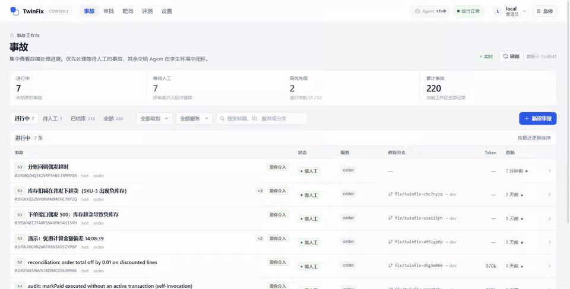
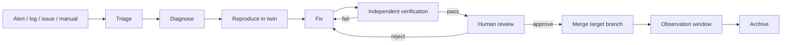
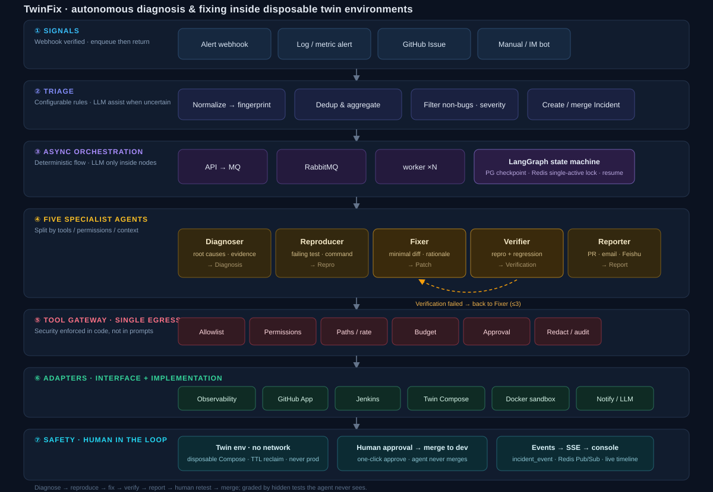

<div align="center">

<h1>TwinFix</h1>

<p><strong>An AI agent that diagnoses, reproduces and fixes bugs inside a disposable isolated environment</strong></p>

<p>From alert to mergeable fix: diagnose → reproduce → fix → independent verification → human approval.<br/>
The agent never touches production, and never grades its own homework — a bug must be proven with a failing test, and a fix must pass hidden tests it never sees.</p>

<p>
  <a href="https://github.com/spacesky-cell/TwinFix/actions/workflows/ci.yml"></a>
  <a href="LICENSE"></a>
  
  
  
  
  
</p>

<p>
  <a href="#quick-start">Quick start</a> ·
  <a href="#capabilities">Capabilities</a> ·
  <a href="#workflow">Workflow</a> ·
  <a href="#architecture">Architecture</a> ·
  <a href="#benchmark">Benchmark</a> ·
  <a href="#development">Development</a> ·
  <a href="README.md">中文</a>
</p>

</div>



## Overview

TwinFix is an AI agent for production incidents. It ingests alerts, error logs, issues or manual reports, then runs triage, diagnosis, reproduction, fixing, verification and reporting end to end. What it hands over is a fix that has already been validated in a running environment, ready for human review and merge.

What existing tools leave open:

- AI-SRE tools (HolmesGPT, K8sGPT and similar) focus on the infrastructure layer — they diagnose but do not modify business code;
- auto-fix tools (Sentry Seer and similar) can open a PR, but the change has never been verified in a running environment.

TwinFix closes that gap: the fix is produced inside a disposable twin environment built from the target branch, and verified by a process independent of the agent that wrote it. Four principles hold throughout:

1. **Reproduce before fixing** — no stable failing test, no code change;
2. **Independent verification** — the fixing agent cannot decide whether it passed;
3. **Verdicts are bound to commits** — every result is tied to a commit SHA and re-verified when the code changes;
4. **A human is the last gate** — merging always requires human approval.

> Supports Java (Maven / Gradle), Python (pytest), Go (go build / go test), TypeScript / JavaScript (node --test) and C# / .NET (dotnet build / dotnet run test project). Real projects can override build and test commands via `project.config.commands`. The twin environment defaults to Docker Compose and also supports Kubernetes; code hosting supports GitHub, GitLab and local git.

TwinFix is currently **v0.1 alpha**: the core loop, benchmark and CI are reproducible. Before production use, validate the adapters against your repositories and infrastructure, and follow [`SECURITY.md`](SECURITY.md) for authentication and network boundaries.

## Capabilities

| Capability | How it is implemented |
|---|---|
| End-to-end loop | 4 LLM agents (diagnose / reproduce / fix / verify) + 1 deterministic Reporter; the Fixer ↔ Verifier loop runs automatically, up to 3 rounds by default |
| Deterministic orchestration | A LangGraph state machine owns the flow; LLMs only reason inside nodes. Each state is checkpointed to PostgreSQL, so a crashed worker resumes from the last step |
| Safety in code | Every tool goes through the gateway with risk-based authorization and audit records; protected paths are read-only; only `fix/twinfix-*` branches may be pushed; merging requires approval |
| Independent verification | The orchestrator reruns the reproduction independently in the sandbox; test integrity is scanned; grading uses hidden tests the agent never sees |
| Context engineering | Log template clustering, evidence queried on demand, historical precedents, read deduplication, exploration budget, context compaction |
| Code intelligence | tree-sitter symbol index: find classes / methods by name, inspect references and callers, outline a file, query git history |
| Multi-language and multi-repo | Five language profiles share one orchestration. Additional repos are checked out under `_repos/<name>` and loaded by service mapping; they can be read-only or fixable, with per-repo commits and merges |
| Multiple entry points and human-in-the-loop | Alertmanager / Grafana alerts, Elasticsearch error-log scanning, GitHub / GitLab Issues, REST API; approval center, multi-approver merges, rejection back to an earlier stage, assignee, post-merge observation window |
| Observable and recoverable | Event table and SSE streaming, full Run / ToolCall / Evidence history, Prometheus metrics, optional OpenTelemetry tracing, hard interrupts on timeout and budget, kill switch |

## Workflow

1. **Ingest**: alert, error log, GitHub / GitLab Issue or manual creation is normalized into a `Signal`
2. **Triage**: fingerprint deduplication, non-bug filtering and severity assignment produce an `Incident`
3. **Diagnose**: query metrics, logs, traces and code; produce root-cause hypotheses, evidence and confidence
4. **Reproduce**: write a failing test in the twin environment; the orchestrator reruns it independently to confirm
5. **Fix**: modify code in a temporary workspace and run the target test plus regression
6. **Verify**: redeploy the twin, confirm the reproduction test turns green, regression passes and the diff is compliant
7. **Review**: a human inspects the report and diff in the console, then approves or rejects (sending it back to the root-cause or patch stage)
8. **Merge**: rebase onto the target branch and re-verify, merge into the target branch (default `dev`), then enter the observation window



The transition table is defined in `server/twinfix/domain/state_machine.py`; LangGraph advances the flow between nodes.

## Quick start

### Demo mode (no LLM key required)

Requires Docker and Compose v2. Demo mode uses a built-in mock agent (stub).

```bash
git clone https://github.com/spacesky-cell/TwinFix.git
cd TwinFix
docker compose -f deploy/compose.dev.yml up -d --build
```

Open <http://localhost:17317>, click **手动创建事故** (create incident), pick a built-in scenario, and watch the incident go through diagnose → reproduce → fix → verify in real time. At **待评审** (awaiting review), click **确认合并** (approve merge).

| Service | Address |
|---|---|
| Console | http://localhost:17317 |
| API / OpenAPI | http://localhost:8000/api · http://localhost:8000/docs |
| RabbitMQ console | http://localhost:15672 (`twinfix` / `twinfix`) |
| Observability stack (optional) | `docker compose -f deploy/observability/compose.observability.yml up -d`: Prometheus :9090 · Elasticsearch :9200 · SkyWalking :12800 · Jaeger :16686 (OTLP :4318) · Grafana :3000 |

### Connect a real LLM

Copy `deploy/.env.example` to `deploy/.env` and set at least:

```dotenv
TWINFIX_AGENT_MODE=llm
TWINFIX_LLM_BASE_URL=https://your-openai-compatible-endpoint/v1
TWINFIX_LLM_API_KEY=...
TWINFIX_LLM_MODEL=...
TWINFIX_SANDBOX=docker
TWINFIX_TWIN_PROVIDER=compose
TWINFIX_TWIN_HOST=host.docker.internal
```

Then rebuild:

```bash
docker compose -f deploy/compose.dev.yml up -d --build
```

The full loop also needs a pre-warmed Maven dependency volume, twin ports and resource limits. Sandbox images for other languages and project language configuration are covered in [`docs/07-arena-eval.md`](docs/07-arena-eval.md) and [`docs/04-interfaces.md`](docs/04-interfaces.md). Secrets such as API keys live only in the untracked `deploy/.env`.

> Authentication is disabled locally by default (`TWINFIX_AUTH_DISABLED=true`), and every port is bound to `127.0.0.1`. Before exposing the service, set `TWINFIX_AUTH_DISABLED=false` and a random `TWINFIX_JWT_SECRET` of at least 32 bytes, then create an admin account:
> `docker compose -f deploy/compose.dev.yml exec twinfix-api twinfix-user create admin`.

## Architecture



```
Entry      Web API / webhooks (Alertmanager, Grafana, GitHub, GitLab, Jenkins) / Elasticsearch log scanner
   ↓
Triage     normalize → fingerprint → dedupe/aggregate → non-bug filter → severity → Incident
   ↓
Orchestration  LangGraph state machine + per-state RabbitMQ dispatch + Redis single-active lock + PostgreSQL checkpoints
   ↓
Agents     Diagnoser / Reproducer / Fixer / Verifier / Reporter
   ↓
Governance Tool gateway: risk-based authorization, approvals, audit, redaction, budgets, integrity scan
   ↓
Adapters   Prometheus + Elasticsearch + SkyWalking / GitHub + GitLab + local git / Jenkins + GitLab CI / Compose / Kubernetes twin / Docker sandbox / email + Feishu / LLM
   ↓
Languages  JavaProfile (Maven / Gradle) | PythonProfile (pytest) | GoProfile (go build / go test) | TypeScriptProfile (node --test) | CSharpProfile (dotnet build / dotnet run)
```

The five agents are split by tools, privileges and context:

| Agent | Responsibility | Key constraint |
|---|---|---|
| Diagnoser | Root-cause hypotheses, evidence, suspicious code locations | Read-only tools + read-only Arthas probe |
| Reproducer | A stable failing test and reproduction command | May only write the test directory; runs in the sandbox |
| Fixer | Produces the patch | May only change workspace source; cannot touch grading tests |
| Verifier | Reproduction turns green, regression, diff review | Read-only source access, independent of the Fixer |
| Reporter | Renders and distributes reports, writes back to the Issue / PR | Deterministic implementation, no LLM calls |

## Benchmark

`arena/` is TwinFix's built-in benchmark suite (Arena): five deliberately buggy demo services and 40 fault-injection cases.

| Suite | Demo service | Cases | Count |
|---|---|---|---|
| Java | demo-shop (Spring Boot + PostgreSQL) | C001–C024 | 24 |
| Python | demo-python (standard library) | P001–P004 | 4 |
| Go | demo-go (net/http) | G001–G004 | 4 |
| TypeScript / JavaScript | demo-ts (node:http) | T001–T004 | 4 |
| C# / .NET | demo-cs (System.Net.HttpListener) | S001–S004 | 4 |

Every fix case consists of three parts: an injection patch disguised as a normal feature, hidden tests TwinFix never sees, and a reference fix. `twinfix-arena validate` runs in CI and verifies that each case really hides the bug, that the hidden tests catch it, and that the reference fix passes.

```bash
cd server
uv run twinfix-arena validate                         # case self-check (no TwinFix service needed)
uv run twinfix-arena validate --repeat 3              # stability check; inconsistent results are marked FLAKY
uv run twinfix-arena eval --label <model>             # end-to-end evaluation
uv run twinfix-arena eval --suite fast                # 6-case fast regression
uv run twinfix-arena eval --suite python              # 4-case Python suite
uv run twinfix-arena eval --suite go                  # 4-case Go suite (use --go-image without a local Go)
uv run twinfix-arena eval --suite typescript          # 4-case TypeScript suite (use --node-image without Node 22+)
uv run twinfix-arena eval --suite csharp              # 4-case C# suite (use --csharp-image without the .NET SDK)
uv run twinfix-arena gate eval/reports/<report>.json  # regression gate: non-zero exit if thresholds fail
uv run twinfix-arena compare a.json b.json            # side-by-side comparison
```

Metrics: conclusion accuracy, root-cause top-1 / top-3 hit rate, reproduction rate, fix rate, false-fix rate, human-intervention rate, duration and tokens. Methodology and historical results are in [`docs/07-arena-eval.md`](docs/07-arena-eval.md) (Chinese) and [`eval/reports/`](eval/reports/). The console's **评测** (evaluation) page can also launch runs and show reports.

## Repository layout

```
server/   Python service: api / worker / orchestrator / agents / gateway / adapters / profiles / domain / arena
web/      React console (incidents, approvals, arena, evaluation, operations, settings)
arena/    Benchmark suite: demo-shop, demo-python, demo-go, demo-ts, demo-cs, twin templates, 40 fault cases
deploy/   Compose, observability stack, Jenkins job template, Maven image configuration
eval/     Evaluation reports (Markdown + JSON)
docs/     Design docs (01–08 + ADR)
```

## Development

```bash
# Infrastructure (repository root)
docker compose -f deploy/compose.dev.yml up -d postgres redis rabbitmq

# Backend
cd server
uv sync
uv run alembic upgrade head
uv run uvicorn twinfix.api.app:create_app --factory --loop twinfix.db:selector_loop --reload  # API
uv run twinfix-worker                                                                          # worker

# Frontend (separate terminal, repository root; /api proxies to 127.0.0.1:8000)
cd web && npm install && npm run dev
```

```bash
# Checks (identical to CI)
cd server && uv run ruff check . && uv run ruff format --check . && uv run mypy twinfix && uv run pytest
cd web && npm run build

# End-to-end smoke test (requires the full compose stack)
cd server && uv run python scripts/e2e_smoke.py --scenario happy
```

## Documentation

The design documents are written in Chinese.

| Document | Contents |
|---|---|
| [01-overview.md](docs/01-overview.md) | Goals, scope, core flow, terminology |
| [02-architecture.md](docs/02-architecture.md) | Layered architecture, module responsibilities, stack, deployment |
| [03-domain-model.md](docs/03-domain-model.md) | Core entities, database tables, incident state machine |
| [04-interfaces.md](docs/04-interfaces.md) | Adapter / plugin / agent / external API contracts |
| [05-safety.md](docs/05-safety.md) | Privilege levels, tool gateway, twin isolation, anti-cheating |
| [06-git-ci-flow.md](docs/06-git-ci-flow.md) | Branch strategy, GitHub App / GitLab, Jenkins, merge and conflicts |
| [07-arena-eval.md](docs/07-arena-eval.md) | Benchmark, case list, evaluation method and results |

See [CHANGELOG.md](CHANGELOG.md) for version history.

## Contributing

Issues and PRs are welcome. Conventions for adding fault cases and regenerating patches are in [`CONTRIBUTING.md`](CONTRIBUTING.md) (Chinese).

## License

[Apache License 2.0](LICENSE). Licenses for third-party components and optional infrastructure are listed in [`THIRD_PARTY_NOTICES.md`](THIRD_PARTY_NOTICES.md).

Please report security issues privately as described in [`SECURITY.md`](SECURITY.md); do not open a public issue.
